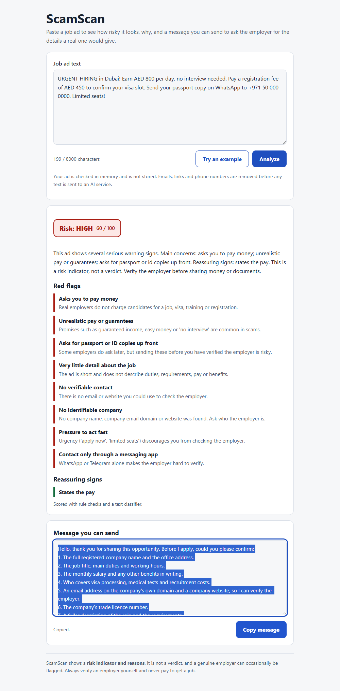
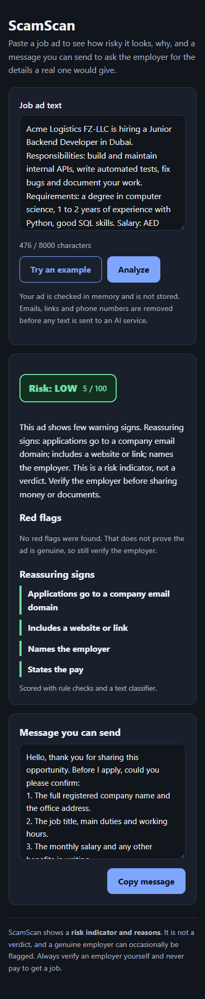

# ScamScan

Paste a job ad and get a **risk level**, the **specific red flags** found, and a **ready-to-send message** asking the poster for the details a real employer would give.

> ScamScan shows a **risk indicator and reasons**. It is not a verdict, a genuine employer can occasionally be flagged, and it never stores the ads you paste.

<table>
  <tr>
    <td valign="top" width="62%">
      
      <br><sub>Desktop: paste an ad, get the level, the red flags and a message to send.</sub>
    </td>
    <td valign="top" width="38%">
      
      <br><sub>Phone, dark mode: a genuine-looking ad scores low.</sub>
    </td>
  </tr>
</table>

The screenshots are of the real running app, checking made-up ads.

## How it works

1. **Rule checks** look for specific warning signs: fee or deposit requests, requests for bank, card or OTP details, a free personal email, a vague ad, no identifiable company, unrealistic pay, pressure to act fast, and messaging-app-only contact. They also look for good signs such as a company email domain.
2. **A text classifier** (TF-IDF + calibrated logistic regression) trained on a public job-posting dataset gives a fraud probability.
3. **A combined score** (30% rules, 70% classifier) gives a 0-100 score and a low, medium or high level. A fee request, or a request for bank, card or OTP details, always forces **high**.
4. **An explanation** in plain English, optionally written by the Claude API. A reply message adapts to the flags found.

Results on held-out data, known failure cases and the honest limits are in [docs/evaluation.md](docs/evaluation.md). The requirements, design and test plan are in [docs/SDLC-plan.md](docs/SDLC-plan.md).

## Quick start

Needs Python 3.12 or newer.

```powershell
python -m venv .venv
.venv\Scripts\activate
pip install -r requirements.txt
```

macOS and Linux: `source .venv/bin/activate` instead of the activate line.

### Run the web app

```powershell
$env:DJANGO_DEBUG = "1"
python manage.py runserver
```

On macOS and Linux: `DJANGO_DEBUG=1 python manage.py runserver`. Then open http://127.0.0.1:8000.

### Run the command-line tool

```powershell
python check.py ad.txt            # prints the result
python check.py ad.txt --json     # machine-readable
python check.py ad.txt --no-model # rules only
```

### Optional: Claude explanation

Set `ANTHROPIC_API_KEY` and the page and CLI (`--llm`) use Claude to write the explanation. Emails, links and phone numbers are removed first, the ad is sent as clearly marked untrusted data, and any API problem falls back silently to the built-in text. Without a key everything works the same. This may cost money on your Anthropic account.

## Train and evaluate the model

A trained model is included in `models/`. To retrain:

```powershell
pip install -r requirements-train.txt
# download data/fake_job_postings.csv, see data/README.md
python train.py
```

To check the tool against your own labelled UAE-style ads, see `data/README.md` and run `python eval_uae.py data/uae_labeled.csv`.

> Only load model files you trained yourself. Python model files can run code when loaded.

## Tests

```powershell
pip install -r requirements-dev.txt
python -m unittest discover -s tests -t . -v
ruff check .
```

The tests cover every rule (with and without negation), scoring and the hard-flag rule, redaction, the reply template, the fallback explanation, the web page (empty, oversized and valid input, CSRF, security headers), the command-line tool, and privacy (no file writes, no logging of ad text).

## Privacy and security

- Ads are analysed in memory. There is **no database** and no code path writes or logs ad text. A test enforces this.
- Emails, links and phone numbers are removed before any text goes to an external API.
- The form is CSRF-protected, input is length-limited, and a strict Content-Security-Policy is sent.
- Secrets come only from environment variables: `DJANGO_SECRET_KEY`, `DJANGO_ALLOWED_HOSTS`, `ANTHROPIC_API_KEY`. With `DJANGO_DEBUG` off the app refuses to start without a secret key.

## Deploy on Render

1. Push this repository to GitHub, including `models/job_scam_model.joblib`.
2. On Render choose **New > Blueprint** and select the repository. `render.yaml` sets up the service and generates the secret key.
3. Optionally add `ANTHROPIC_API_KEY` in the service's environment settings.
4. Free instances sleep when idle, so the first request after a pause can be slow.

To roll back, redeploy an earlier tagged commit. Check the Python version in `render.yaml` against what Render currently supports.

## Project layout

| Path | Purpose |
|---|---|
| `scamscan/` | Core logic with no Django dependency: `rules.py`, `model.py`, `combine.py`, `explain.py`, `scorer.py`, `evaluation.py` |
| `webapp/`, `checker/` | The Django project and the single-page app |
| `check.py`, `train.py`, `eval_uae.py` | Command-line tools |
| `tests/` | Automated tests |
| `docs/` | Plan, evaluation report, screenshots, changelog |
| `data/`, `models/` | Dataset (not committed) and the trained model |

## Limits

English only. The classifier was trained on a mostly non-UAE dataset, so on UAE-style ads the rules carry more of the weight than the numbers suggest. The rules and thresholds are judgement calls that need checking against real UAE-style ads. Rule checks use fixed phrasings and can miss new wording. It cannot tell you an employer is genuine, only what looks risky.

## Credits

Training data: Vidros, S., Kolias, C., Kambourakis, G. and Akoglu, L. (2017), *Automatic Detection of Online Recruitment Frauds: Characteristics, Methods, and a Public Dataset*, Future Internet 9(1), 6. Verify this citation and the dataset licence on the Kaggle dataset page.
