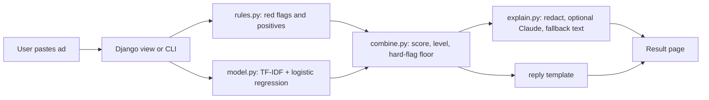

# ScamScan: SDLC Plan (v0.1, draft for approval)

**One-line summary:** a web tool where a job seeker pastes a job ad and gets a risk score, the specific red flags found, and a ready-to-send message asking the poster for the details a real employer would give.

**Owner:** Aysha Nahan | **Status:** v0.1.0 built (milestones M1-M6). Not yet done: the hand-labelled UAE-style set and a live deployment. See [CHANGELOG.md](CHANGELOG.md) for changes from this plan. | **Date:** 2026-10-21, updated 2026-11-03

| Phase | What happens | Status |
|---|---|---|
| 1. Requirements | What we build and how we know it works | Drafted (this file) |
| 2. Design | How it is structured and why | Drafted (this file) |
| 3. Implementation | Build in small milestones | Waiting for approval |
| 4. Testing | Prove each requirement is met | Planned |
| 5. Deployment | Put a live demo online | Planned |
| 6. Maintenance | Keep it correct and improving | Planned |

---

## 1. Requirements

### 1.1 Problem and users
Job seekers in the UAE often receive ads through WhatsApp, Telegram and social media with no company name, a personal email address and no way to verify the employer. Some of these are scams that ask for fees or ID documents. There is no quick tool that explains *why* an ad looks risky.

- **Primary user:** a job seeker who pastes an ad and wants a fast, plain-English second opinion.
- **Maintainer:** the project owner, who needs the code to be understandable, tested and easy to extend.

### 1.2 Scope
**In scope (MVP):** paste text, rule checks, a trained text classifier, a combined score, an explanation, a reply template, a command-line tool, a Django web page, an evaluation report.

**Out of scope for now:** user accounts, scraping job sites, fetching a posting from a URL, Arabic-language ads, a browser extension, company registry lookups, and naming or accusing any real person or company.

### 1.3 Functional requirements
Priority uses MoSCoW (Must, Should, Could).

| ID | Requirement | Priority | Acceptance criteria |
|---|---|---|---|
| FR-1 | The user can paste an ad (up to 8,000 characters) and get an analysis | Must | Empty or oversized input shows a clear error; valid input returns a result |
| FR-2 | Rule checks detect: free-email contact, fee or deposit requests, requests for bank, card or OTP details, requests for passport or ID copies (a soft flag, since some genuine Gulf ads ask for them), vague ads, no identifiable company, unrealistic pay or guarantees, urgency pressure, messaging-app-only contact, no verifiable contact | Must | Each rule has a unit test with a positive and a negative example; "no fee" wording does not trigger the fee rule |
| FR-3 | Positive signals are shown (company-domain email, website, detailed duties, stated pay) | Should | Positives lower the score and appear in the result |
| FR-4 | A TF-IDF + logistic regression classifier gives a fraud probability | Must | `train.py` trains from the public dataset and saves a model; the app still works if no model file exists |
| FR-5 | A combined score (0-100) and a level (low, medium, high) are produced; fee requests and requests for bank, card or OTP details force "high" | Must | Unit tests cover thresholds and the hard-flag rule |
| FR-6 | A plain-English explanation is shown; the Claude API is used when a key is set, otherwise a built-in text | Should | Works with no API key and no network; falls back silently on API error |
| FR-7 | A ready-to-send reply asks for company name, role details, pay, contact email and visa handling | Should | Template adapts to the flags found (for example, asks for a company email only if a free email was used) |
| FR-8 | Emails and phone numbers are removed before any text goes to an external API; ad text is never stored | Must | Unit test for redaction; no code path writes ad text to disk or logs |
| FR-9 | A command-line tool runs the same analysis | Should | `python check.py ad.txt` prints the result |
| FR-10 | A Django page provides the paste box and result display | Must | Works on phone and desktop widths; includes the disclaimer |
| FR-11 | Training prints an evaluation comparing rules alone, model alone and combined | Must | Reports ROC AUC, average precision, precision, recall and F1 on a held-out test split |

**Could (later):** a "was this right?" feedback button that stores only the result level and the user's answer, Arabic support, a browser extension, and URL input.

### 1.4 Non-functional requirements
| ID | Requirement |
|---|---|
| NFR-1 | Result in under 2 seconds without the LLM, under 10 seconds with it |
| NFR-2 | Privacy: no accounts, no ad storage, no personal data in logs |
| NFR-3 | Wording: show a *risk level and reasons*, never "this is a scam"; always show a disclaimer |
| NFR-4 | Reproducible: fixed random seed, pinned dependency versions, documented dataset source |
| NFR-5 | Secrets (API key, Django secret key) come only from environment variables |
| NFR-6 | Core logic (rules, scoring, redaction) is covered by automated tests |
| NFR-7 | The page is readable on a phone, with sufficient colour contrast and keyboard-usable controls |

### 1.5 Assumptions, constraints and risks
| Item | Detail | Mitigation |
|---|---|---|
| Dataset mismatch | The public dataset (Kaggle "Real / Fake Job Posting Prediction", based on EMSCAD) is English and mostly non-UAE, so it may not match WhatsApp-style Gulf ads | Give rules more weight (60/40); build a small hand-labeled UAE-style test set; report both results separately |
| No UAE labeled data | None exists publicly | Collect 30+ ads yourself with names, emails and phone numbers removed |
| Class imbalance | Fraud is a small fraction of the dataset | Use balanced class weights; report precision and recall, never plain accuracy |
| False accusations | A legitimate poster could be flagged | Risk wording, visible reasons, no naming of companies in the demo |
| Prompt injection | The ad text is untrusted and could contain instructions | Send it to the LLM inside a clearly marked data block, with an instruction to ignore commands in it; output is only displayed, never executed |
| Model file trust | Loading a pickled model runs code | Only load model files you trained yourself |
| Dataset licence | Terms apply | Read the licence on the dataset page and cite the source in the README (Vidros et al., 2017, *Future Internet*; verify the citation on the dataset page) |

### 1.6 Success criteria (targets, to revisit after the first evaluation)
- Held-out test split: combined recall of at least 0.70 at precision of at least 0.50 for the fraud class.
- Hand-labeled UAE-style set: at least 80% agreement with your own labels.
- All Must requirements have passing tests; the live demo is online with a README and screenshots.

---

## 2. Design

### 2.1 Architecture


### 2.2 Modules
| Module | Responsibility |
|---|---|
| `scamscan/constants.py` | Thresholds, weights, paths |
| `scamscan/rules.py` | Red-flag and positive-signal checks; returns flags with weights |
| `scamscan/model.py` | Load dataset, train, evaluate, save and load the classifier |
| `scamscan/combine.py` | Blend rule and model scores; map score to level; apply hard-flag rule |
| `scamscan/explain.py` | Redaction, optional Claude explanation, reply template |
| `scamscan/scorer.py` | `analyze(text)` ties everything together |
| `train.py`, `check.py` | Command-line entry points |
| `webapp/`, `checker/` | Django project and the single-page app |

### 2.3 Scoring design
- Each rule has a weight (for example fee request 6, free email 3, vague ad 2). Positive signals subtract 0.75 each.
- `rule_prob = clamp(sum / 10, 0, 1)`
- `final = 0.3 * rule_prob + 0.7 * model_prob` (or `rule_prob` alone if no model is available). *Originally 0.6 / 0.4; changed after the first evaluation, see [evaluation.md](evaluation.md).*
- Levels: low below 0.25, medium 0.25 to 0.55, high 0.55 and above.
- Hard flags (fee request, or a request for bank, card or OTP details) force at least "high". A request for passport or ID copies is a soft flag (weight 2).

### 2.4 Interface contract
`analyze(text, classifier=None, use_llm=False)` returns a dictionary:
`level`, `score` (0-100), `flags` (label, detail), `positives`, `model_prob` (or `None`), `summary`, `reply_template`, and from v0.1.1 `caveat` (what the level does and does not mean) and `verify_steps` (checks that catch what the ad text cannot).

### 2.5 Data design
- Training data: the public CSV. Text is built from title, company profile, description, requirements and benefits; the label is `fraudulent`.
- The MVP has no database. A later feedback table would hold only: id, created time, level, user's answer. Never the ad text.

### 2.6 Key decisions
| Decision | Why |
|---|---|
| Django for the web layer | Matches your resume, easy to deploy, grows into a database and accounts later |
| Rules first, ML second | Rules are explainable and work on UAE-style ads; the classifier adds measured, learned evidence |
| TF-IDF + logistic regression | Fast, interpretable baseline; a stronger model can be compared later |
| LLM only for the explanation | Keeps scoring deterministic and testable; the app works without an API key |
| No storage of ad text | Ads can contain personal details; collecting them adds risk and no value for the MVP |

### 2.7 Security and privacy design
CSRF protection on the form, input length limit, no logging of ad text, secrets from environment variables, redaction before any API call, untrusted-data framing in the prompt, `DEBUG` off in production.

### 2.8 UI sketch
Title and one-line explanation, a large paste box with a character counter, an "Analyze" button. The result shows a coloured risk badge with the score, a list of red flags (each with a one-line reason), green positives, the explanation, the reply template with a copy button, and a footer disclaimer ("a risk indicator, not a verdict").

---

## 3. Implementation plan

### 3.1 Repository layout
```
scamscan/
  manage.py  requirements.txt  README.md  train.py  check.py
  scamscan/    core package (no Django dependency)
  webapp/      Django settings and urls
  checker/     Django app (view, template)
  tests/       unit and integration tests
  docs/        this plan, evaluation report
  data/        dataset goes here (not committed)
  models/      trained model (not committed)
```

### 3.2 Workflow
- Git from day one. `main` always works; each milestone is a `feature/<name>` branch merged by pull request, even when working alone.
- Commit messages follow Conventional Commits (`feat:`, `fix:`, `test:`, `docs:`).
- A GitHub Actions workflow runs the tests on every push.
- Tag releases with semantic versions (`v0.1.0` for the MVP).

### 3.3 Milestones
| # | Milestone | Done when |
|---|---|---|
| M1 | Repo, structure, CI, empty tests running | Pipeline is green |
| M2 | Rules engine and tests (FR-2, FR-3) | Every rule has positive and negative tests |
| M3 | Classifier training and evaluation (FR-4, FR-11) | Evaluation table generated from the real dataset |
| M4 | Scorer, redaction, explanation, reply template, CLI (FR-5 to FR-9) | End-to-end run on sample ads |
| M5 | Django page (FR-1, FR-10) | Works locally on desktop and phone width |
| M6 | UAE-style evaluation set, README with screenshots, deployment | Live demo link and results documented |

---

## 4. Test plan

### 4.1 Levels
| Level | What | How |
|---|---|---|
| Unit | Each rule, redaction, score blending, level thresholds, reply template | `unittest` on made-up sample ads |
| Integration | `analyze()` end to end; training pipeline runs and saves a loadable model | Synthetic data, used **only** to prove the pipeline runs |
| Model evaluation | Quality on unseen data | Held-out split from the real dataset; plus the hand-labeled UAE-style set |
| Security and privacy | No ad text stored or logged; API key never printed; redaction works | Targeted tests and code review |
| Manual and usability | Phone layout, copy button, error messages | Checklist before each release |

### 4.2 Requirement coverage
| Requirement | Verified by |
|---|---|
| FR-1 | View test with empty, oversized and valid input |
| FR-2, FR-3 | Rule unit tests (positive and negative cases, negation such as "no fees") |
| FR-4, FR-11 | Training integration test; real-dataset evaluation report |
| FR-5 | Scoring unit tests, including the hard-flag floor |
| FR-6 | Test that the fallback text works with no key; manual check with a key |
| FR-7 | Template tests for different flag combinations |
| FR-8, NFR-2 | Redaction tests; search the code for any write of ad text |
| FR-9, FR-10 | CLI test; manual UI checklist |

### 4.3 Rules for honest results
- Metrics from synthetic data are never reported.
- Report precision and recall for the fraud class, not accuracy alone.
- Show the rules-only, model-only and combined results side by side.
- Record known failure cases in the README.

### 4.4 Exit criteria
All Must requirements pass, no known high-severity defects, the evaluation report exists, and the README states the limits.

---

## 5. Deployment plan
- Host on Render as a web service, running Django with gunicorn.
- Environment variables: `DJANGO_SECRET_KEY`, `DJANGO_DEBUG=0`, `DJANGO_ALLOWED_HOSTS`, and optionally `ANTHROPIC_API_KEY`.
- The model file is generated by the training script. Either commit a small model or run training in the build step if the dataset can be supplied; decide at M6 based on file size.
- Free hosting sleeps when idle, so the first request may be slow. Note this in the README.
- Rollback: redeploy the previous git tag.

## 6. Maintenance plan
- Review rules and thresholds every few months as scam wording changes; add a test for each new rule.
- Retrain and re-evaluate when new labeled data is added; keep a dated results log in `docs/`.
- Update dependencies regularly; CI catches breakage.
- Keep a changelog and semantic version tags.
- Known limits stay documented: English only, trained on a non-UAE dataset, a risk indicator and not a verdict.

---

## 7. Decisions needed before implementation
1. **Django web layer:** OK as planned? (Default: yes.)
2. **Public demo:** deploy it online, or keep it local for now? (Default: deploy at M6.)
3. **Claude API explanation:** needs your own API key and may cost money. (Default: optional, off unless a key is set.)
4. **Labeled UAE-style ads:** can you collect 30+ ads with personal details removed? (Default: yes, I will give you a simple CSV template.)
